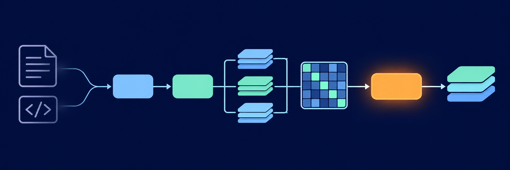
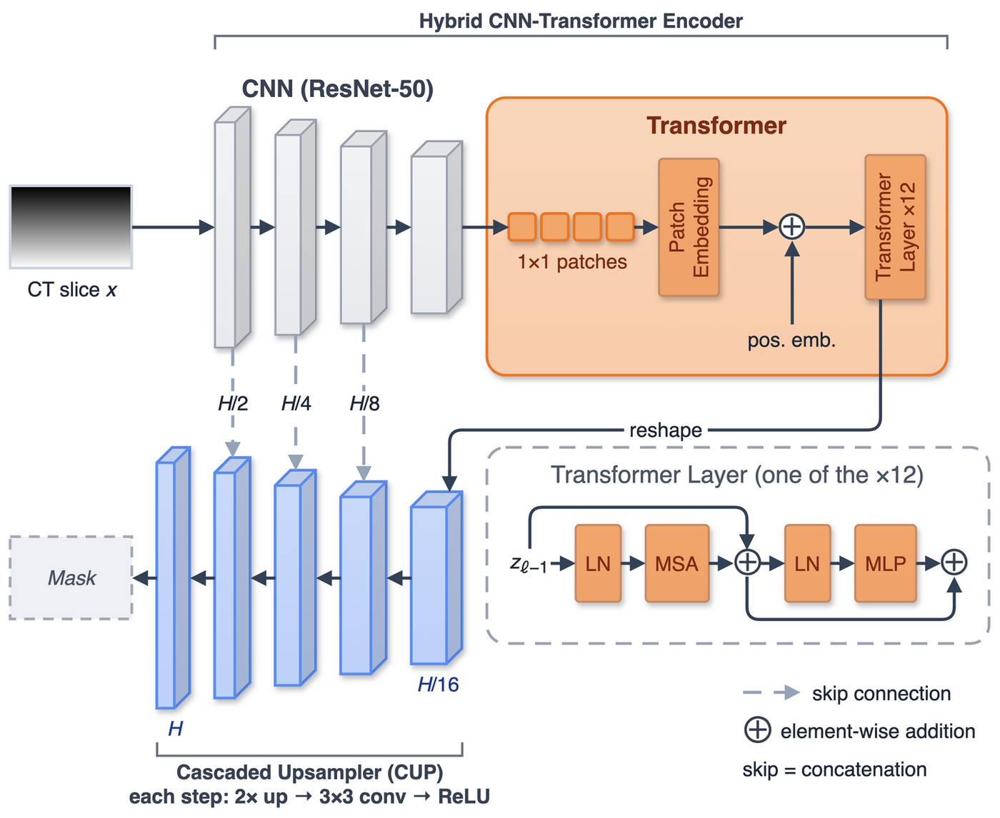
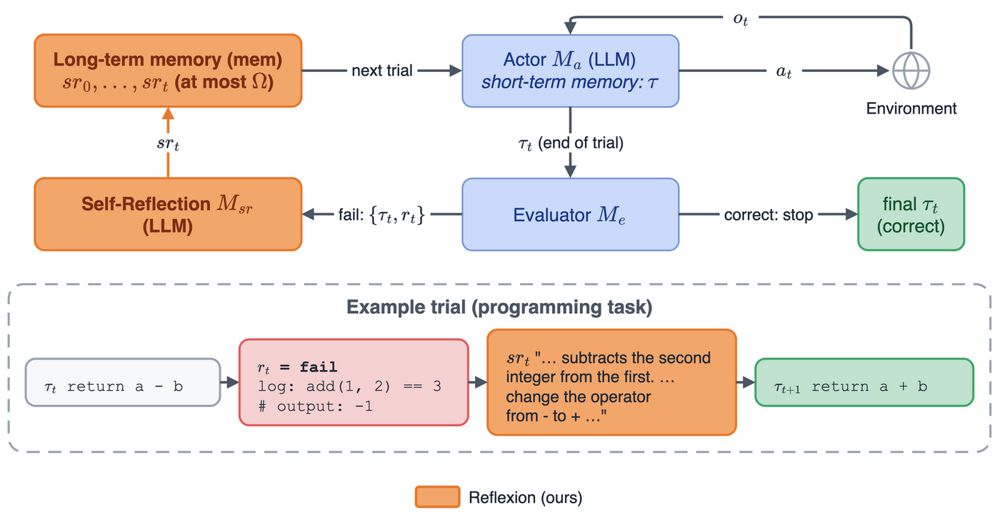
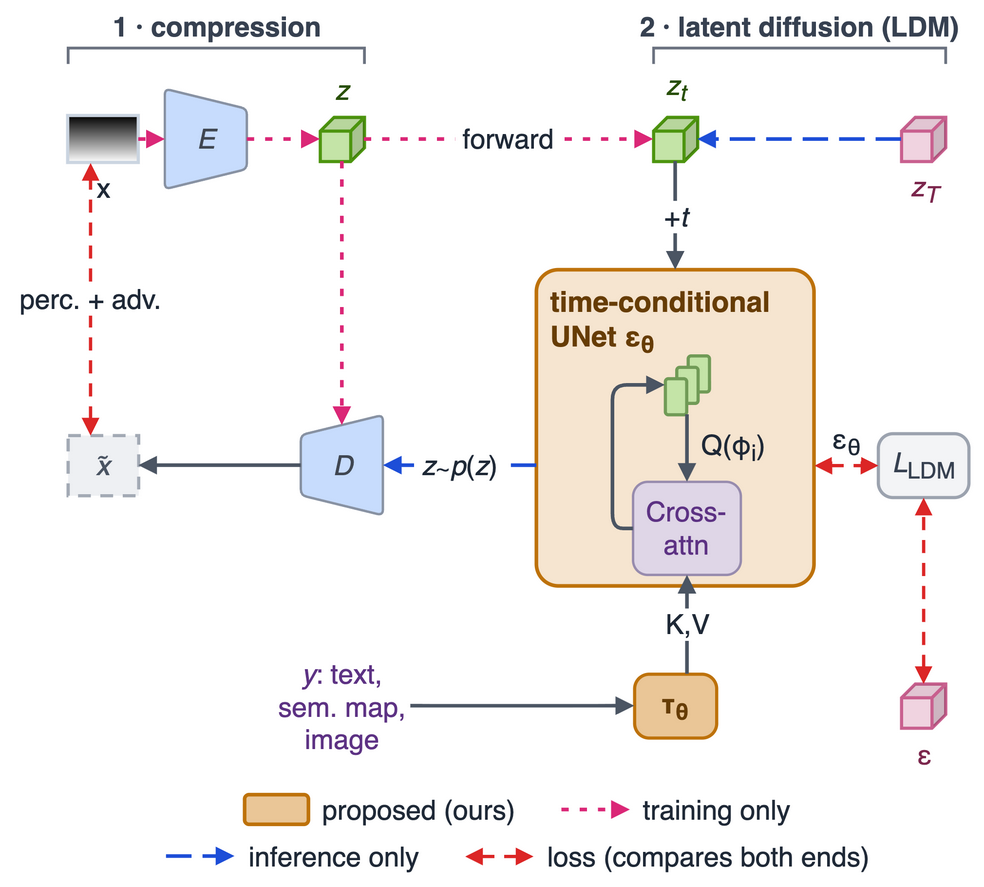
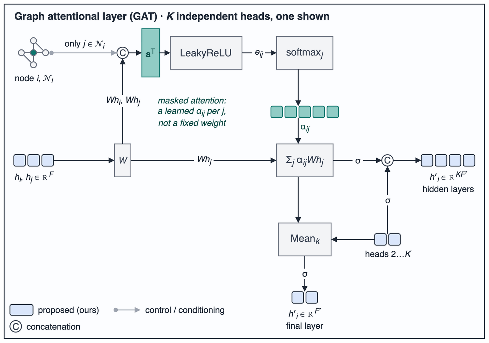
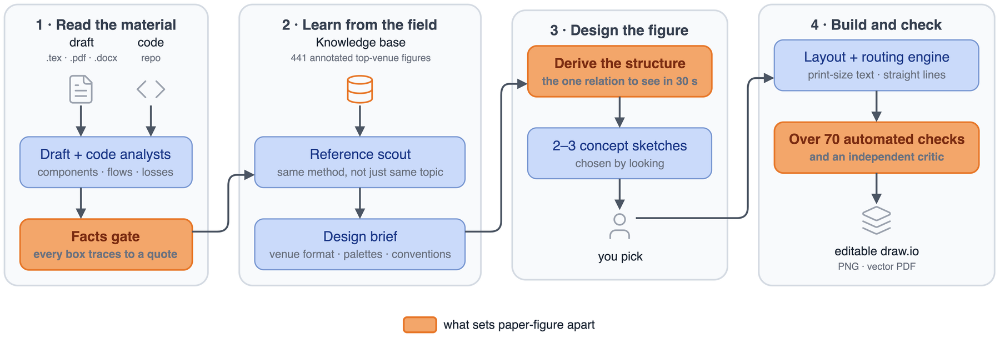

<p align="center"></p>

<h1 align="center">paper-figure</h1>

<p align="center"><b>Publication-quality method figures for AI papers, from your draft and your code.</b><br>
A Claude Code skill. Every box traces to your paper. Every figure comes out editable.</p>

<p align="center"><b>English</b> · <a href="README.zh-CN.md">中文</a></p>

---

The method figure is the first thing a reviewer reads and the last thing you have time for. paper-figure draws it
with you: it reads the method section and the code, studies how published papers draw the same kind of method,
proposes a few compositions for you to choose from, then builds the figure at the exact width and font size your
venue prints, checks it, and hands you a **draw.io file you can keep editing** plus PNG and a vector PDF.

Ask Claude for a figure the way you would ask a co-author:

> *"Draw the method figure for my paper. The draft is `paper/`, the code is `src/`, we're submitting to CVPR."*
>
> *"帮我画论文的方法图，草稿在 main.tex，代码在 ./model"*

## What makes it different

- **Faithful to your paper, by construction.** Every component, arrow and loss in the figure comes with a quote from
  your method text or a `file:line` in your code. A facts gate checks the finished figure against the paper before
  you see it. Your new modules keep their exact names.
- **Learns from the field, by method rather than topic.** A knowledge base of **441 annotated figures from top venues
  across 24 research areas** records how each figure is arranged, what its core relation is and what is worth
  copying. A two-tower contrastive model is matched with figures of two-tower contrastive models, not just papers
  from the same area.
- **Designs before it decorates.** It first works out the one relation a reader must see in 30 seconds (a pairing, a
  loop, a set of stages), then picks the layout that shows it. Two or three concept sketches are rendered side by
  side so you choose by looking, not by reading a description.
- **Built for print.** Text is sized for your venue's column width (18 venue formats, from NeurIPS and CVPR to
  Nature, IEEE and ACM). The contribution stands out in colour and in grayscale. The PDF embeds no Type 3 fonts.
- **Checked, not just generated.** Over 70 automated checks cover overlaps, lines through text, arrowheads without a
  shaft, colour-blind confusion, contrast and printed font size, and an independent critic reviews the render
  before delivery.
- **Honest.** It never invents a result image, a sample or a number. Anything it could not verify is listed in the
  report, never called "passed".

## Gallery

Each figure below was drawn **blind**: in a benchmark run the skill got only the paper's method text and its code,
never the paper's own figure. Input images are grey stand-ins (no third-party pixels in this repository).

<table>
<tr>
<td width="50%"><br><sub><b>TransUNet</b> · overview: CNN encoder, Transformer and cascaded upsampler, with the Transformer layer expanded</sub></td>
<td width="50%"><br><sub><b>Reflexion</b> · an agent loop with memory and self-reflection, plus a worked example trial drawn as code cards</sub></td>
</tr>
<tr>
<td width="50%"><br><sub><b>Latent Diffusion</b> · two stages (compression, then diffusion in latent space), training-only and inference-only paths told apart by line style</sub></td>
<td width="50%"><br><sub><b>GAT</b> · module detail: one attention head on a small graph, then the multi-head output</sub></td>
</tr>
</table>

## How it works

<p align="center"></p>
<p align="center"><sub>This diagram was drawn by paper-figure itself, from <a href="docs/readme/pipeline.blueprint.json">this blueprint</a>.</sub></p>

1. **Read the material.** A draft analyst reads the method section (LaTeX project or Overleaf zip, PDF, Word,
   Markdown) and a code analyst reads the repository. Both record components, data flows, losses and stages with
   their evidence. The quotes are verified against the source text in any language, Chinese included.
2. **Learn from the field.** A reference scout searches for 5–10 published figures of the most similar methods and
   looks at each one. The knowledge base adds figures of the same paradigm and architecture. The result is a design
   brief: the venue's format, palettes with colour-blind safety numbers, the field's drawing conventions and the
   best matching examples.
3. **Design the figure.** The plan derives the figure's structure from your method (what the reader must see first,
   which parts belong together, what each colour means), then compares it with how published figures drew the same
   structure. Concept sketches are rendered for you to pick from; nothing is drawn in full until you agree.
4. **Build and check.** A layout and routing engine places every block, keeps lines straight and out of text, and
   fits the text to your venue's print size. The build is linted, opened and reviewed by an independent critic,
   fixed once, and delivered with a report: what is drawn, what was left out and why, the references it learnt
   from, and a caption draft.

In interactive mode it asks you four times: the blueprint, the assets, the style, and the delivery. In auto mode it
takes the stated default at each point and records why.

## What you get

| File | What it is |
|---|---|
| `fig.drawio` | the editable source: real containers, attached arrows, embedded images. Edit it in draw.io and paper-figure can read your edits back (`absorb`). |
| `fig.png` | 300 dpi at your venue's text or column width |
| `fig.pdf` | vector, one page, sized to the column, for `\includegraphics` |
| `fig.blueprint.json` | the figure as structured data, to rebuild or restyle it |
| `report.md` | the figure explained, omissions with reasons, references used, open issues, a caption draft |

## Quick start

**Requirements:** Python ≥ 3.10 with `Pillow`, `jsonschema` and `pypdf`; [poppler](https://poppler.freedesktop.org/)
(`brew install poppler` / `apt install poppler-utils`); and [draw.io desktop](https://www.drawio.com) for export
(headless Linux: `xvfb-run`).

```bash
git clone https://github.com/dong845/paper-figure ~/.claude/skills/paper-figure
pip install Pillow jsonschema pypdf
PYTHONPATH=~/.claude/skills/paper-figure python3 -m paperfig doctor   # checks everything above
```

Then, in Claude Code, ask for a figure. The skill triggers on requests such as *"draw the architecture diagram for
this repo"*, *"make a teaser figure for our NeurIPS submission"* or *"把这个模块画成细节图"*.

### Using the engine directly

The render engine also works on its own, from a hand-written blueprint:

```bash
python3 -m paperfig build examples/restormer.blueprint.json --style soft-pastel --out out/
python3 -m paperfig kb match --paradigm CLIP --architecture two-tower      # figures of the same method
python3 -m paperfig kb arrangements --partition lanes --relation pairing   # layouts to learn from
python3 -m paperfig style derive --base soft-pastel --from-cards DIR --out style.json
```

Five style recipes ship (`soft-pastel`, `depth-cv`, `editorial-minimal`, `compact`, `drawio-default`). Their
sections can be mixed (`--mix effects=depth-cv`), and a run can derive its own palette from the references it
learnt from.

## Scope and limits

- It draws **method figures**: overviews, teasers, module details. It does not plot results or charts.
- Export needs draw.io desktop. It is developed on macOS; on Linux, draw.io runs under `xvfb-run`.
- A full run dispatches a few subagents (two analysts, a scout, a critic), so it uses more tokens than a single
  prompt. Reusing knowledge-base cards keeps repeat runs cheaper.
- Reference figures are only studied during a run; they are never shipped or stored in this repository.

## Credits

Icons from [Lucide](https://lucide.dev) (ISC licence). The banner at the top of this page was generated with Codex;
every other figure on this page was drawn by paper-figure.
