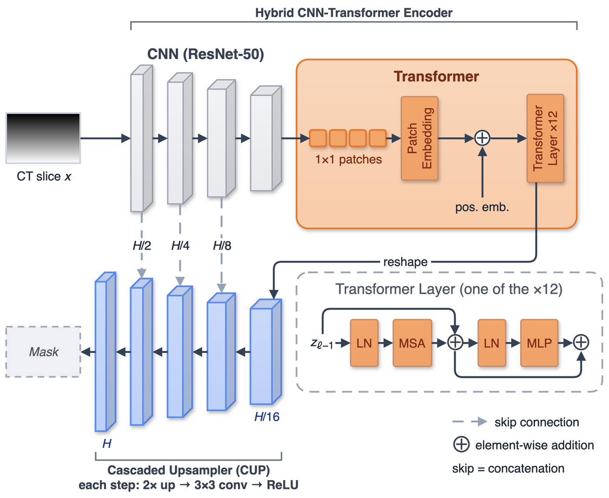
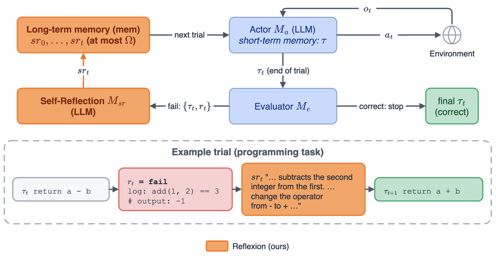
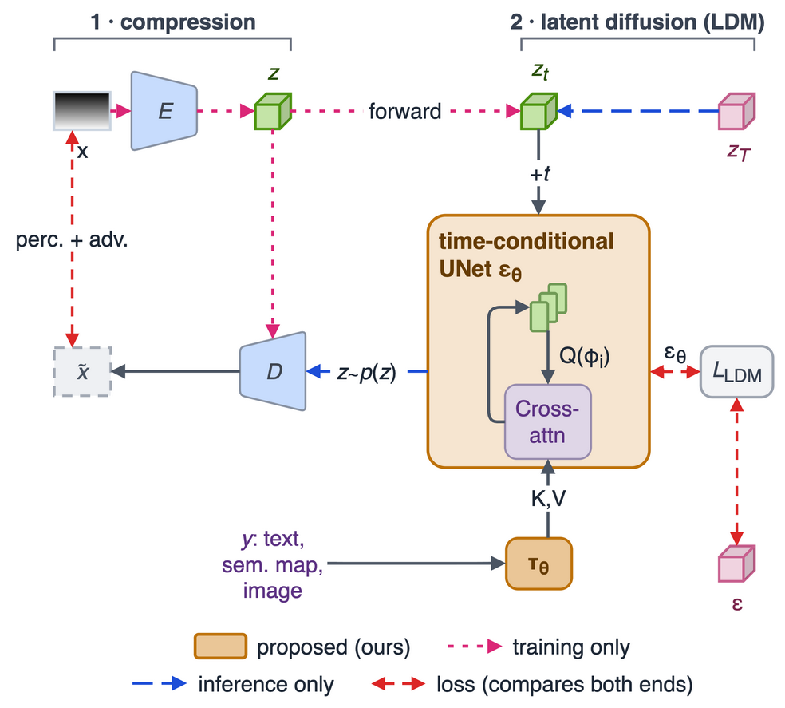
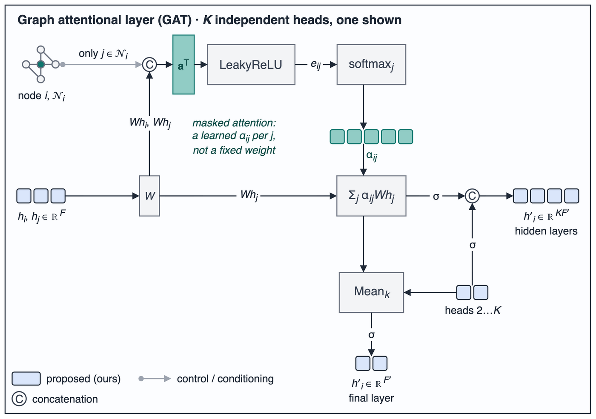
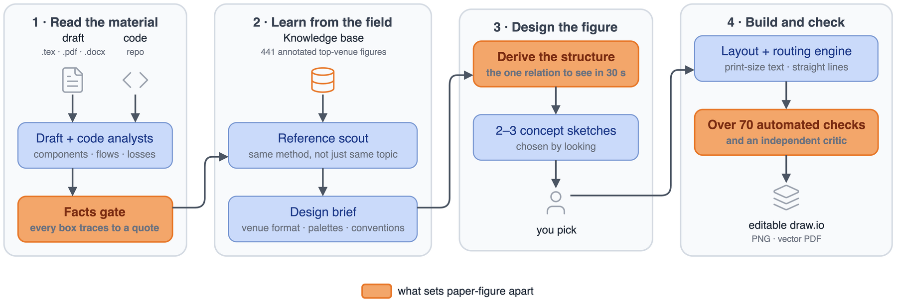

<p align="center"></p>

<h1 align="center">paper-figure · 科研作图专家</h1>

<p align="center"><b>从你的论文草稿和代码，画出可直接投稿的 AI 论文方法图。</b><br>
一个 Claude Code skill：图里每个框都能追溯到论文原文，每张图都能继续编辑。</p>

<p align="center"><a href="README.md">English</a> · <b>中文</b></p>

---

方法图是审稿人最先看的东西，却往往是作者最后才有时间做的事。paper-figure 和你一起画：它读方法章节和代码，
研究已发表论文怎样画同一类方法，给出几种构图让你挑，再按投稿会议的实际栏宽和字号出图、逐项检查，最后交给你
一份**可以继续编辑的 draw.io 文件**，外加 PNG 和矢量 PDF。

像跟合作者说话一样提需求就行：

> *"帮我画论文的方法图，草稿在 main.tex，代码在 ./model，投 CVPR。"*
>
> *"Draw the method figure for my paper. The draft is `paper/`, the code is `src/`."*

## 它和别的方式有什么不同

- **忠于论文，靠机制保证。** 图里每个模块、每条箭头、每个损失都附有方法原文的引文或代码的 `file:line`。成图在
  给你看之前要先过一道"事实门"，与论文逐条核对。你提出的新模块保留原名。
- **向同行学，按方法而不是按话题。** 知识库收录了 **441 张来自顶会顶刊的标注图，覆盖 24 个研究方向**，记录每张
  图怎么排布、核心关系是什么、哪些值得学。画双塔对比学习模型时，参考的是双塔对比学习模型的图，而不只是同领域的论文。
- **先设计，再上色。** 先想清楚读者 30 秒内必须看懂的那个关系（配对、循环、分阶段……），再选能表达它的版式。
  2–3 个构图草图并排渲染，你看图做选择，而不是读描述做选择。
- **为印刷而生。** 字号按会议栏宽计算（内置 18 种排版格式，从 NeurIPS、CVPR 到 Nature、IEEE、ACM）。你的贡献
  在彩色和黑白打印下都醒目。PDF 不嵌入 Type 3 字体。
- **检查过，而不只是生成出来。** 70 多项自动检查覆盖重叠、线穿文字、箭头没有箭杆、色盲混淆、对比度、印刷字号等；
  交付前还有一个独立的评审 agent 看渲染结果。
- **诚实。** 从不编造结果图、样本或数字。没能核实的内容会写进报告，绝不写成"已通过"。

## 作品示例

下面每张图都是**盲画**的：基准测试中，skill 只拿到论文的方法文字和代码，从没看过论文原图。输入图片是灰色占位图
（仓库里不含任何第三方图片）。

<table>
<tr>
<td width="50%"><br><sub><b>TransUNet</b> · 总览图：CNN 编码器、Transformer 与级联上采样，Transformer 层单独展开</sub></td>
<td width="50%"><br><sub><b>Reflexion</b> · 带记忆与自我反思的 agent 循环，并用代码卡片画出一次示例试验</sub></td>
</tr>
<tr>
<td width="50%"><br><sub><b>Latent Diffusion</b> · 两阶段（先压缩，再在潜空间扩散），用线型区分仅训练与仅推理的路径</sub></td>
<td width="50%"><br><sub><b>GAT</b> · 模块细节图：在一个小图上画出一个注意力头，再到多头输出</sub></td>
</tr>
</table>

## 工作原理

<p align="center"></p>
<p align="center"><sub>这张流程图由 paper-figure 自己画出，源文件是<a href="docs/readme/pipeline.blueprint.json">这份 blueprint</a>。</sub></p>

1. **读材料。** 草稿分析 agent 读方法章节（LaTeX 工程或 Overleaf zip、PDF、Word、Markdown），代码分析 agent
   读代码仓库。两者都记录模块、数据流、损失和阶段，并附上证据。引文会在原文中核验，支持中文等任意语言。
2. **向同行学。** 参考检索 agent 找 5–10 篇方法最相近的已发表论文，逐张看它们的图；知识库再补充同一范式、同一
   架构的图。最后汇成一份设计简报：会议格式、附色盲安全数据的配色方案、该领域的画图惯例，以及最匹配的范例。
3. **做设计。** 方案先从你的方法推导出图的结构（读者先看什么、哪些部分是一组、每种颜色代表什么），再对照已发表
   的图怎样画同类结构。构图草图渲染出来供你挑选；你点头之前不会画完整的图。
4. **出图与检查。** 布局与走线引擎摆放每个模块，让线保持笔直、不穿过文字，并把字号调到会议的印刷尺寸。成图经过
   自动检查、亲自查看和独立评审，修改一轮后交付，附一份报告：画了什么、省略了什么及原因、参考了哪些论文，以及
   一段图注草稿。

交互模式下会在四个节点征求你的意见：blueprint、素材、风格、交付。自动模式下每个节点采用默认选项，并记录理由。

## 交付内容

| 文件 | 说明 |
|---|---|
| `fig.drawio` | 可编辑源文件：真正的容器、吸附在模块上的箭头、内嵌图片。在 draw.io 里改完，paper-figure 能把你的改动读回来（`absorb`）。 |
| `fig.png` | 按会议正文或单栏宽度输出的 300 dpi 图 |
| `fig.pdf` | 矢量、单页、按栏宽缩放，直接 `\includegraphics` |
| `fig.blueprint.json` | 结构化的图描述，可重建或换风格 |
| `report.md` | 图的说明、省略项及原因、参考文献、未解决问题、图注草稿 |

## 快速开始

**环境要求：** Python ≥ 3.10，安装 `Pillow`、`jsonschema`、`pypdf`；[poppler](https://poppler.freedesktop.org/)
（`brew install poppler` / `apt install poppler-utils`）；导出需要 [draw.io 桌面版](https://www.drawio.com)
（无图形界面的 Linux 用 `xvfb-run`）。

```bash
git clone https://github.com/dong845/paper-figure ~/.claude/skills/paper-figure
pip install Pillow jsonschema pypdf
PYTHONPATH=~/.claude/skills/paper-figure python3 -m paperfig doctor   # 检查上面所有依赖
```

然后在 Claude Code 里直接提需求，例如 *"把这个仓库的模型结构画成架构图"*、*"给我们投 NeurIPS 的论文做一张
teaser 图"*、*"把这个模块画成细节图"*，skill 会自动触发。

### 直接使用渲染引擎

渲染引擎也可以单独使用，输入手写的 blueprint：

```bash
python3 -m paperfig build examples/restormer.blueprint.json --style soft-pastel --out out/
python3 -m paperfig kb match --paradigm CLIP --architecture two-tower      # 同一方法的图
python3 -m paperfig kb arrangements --partition lanes --relation pairing   # 可借鉴的版式
python3 -m paperfig style derive --base soft-pastel --from-cards DIR --out style.json
```

内置五套风格（`soft-pastel`、`depth-cv`、`editorial-minimal`、`compact`、`drawio-default`），各部分可以混搭
（`--mix effects=depth-cv`）；每次运行也可以从参考图里提取自己的配色。

## 适用范围与限制

- 只画**方法图**：总览图、teaser、模块细节图。不画实验结果的曲线或图表。
- 导出依赖 draw.io 桌面版。开发环境是 macOS；Linux 上用 `xvfb-run` 运行 draw.io。
- 一次完整运行会调用几个子 agent（两个分析、一个检索、一个评审），token 消耗比单条提示多；复用知识库卡片能让
  后续运行更省。
- 参考图只在运行时用于学习，从不随 skill 分发，也不存入本仓库。

## 致谢

图标来自 [Lucide](https://lucide.dev)（ISC 许可）。页首横幅由 Codex 生成；本页其余所有图都由 paper-figure 绘制。
